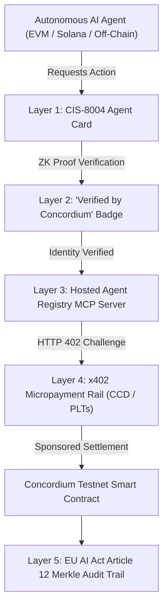

# Concordium Agent Sentinel

[](./test/test_concordium_sentinel.py)
[](https://concordium.com)
[](./schemas/agent_card.json)
[](./src/x402_gateway.py)
[](./src/eu_ai_act_logger.py)
[](https://amazing200guy1-a11y.github.io/concordium-agent-sentinel/)
[](./LICENSE)

> **Zero-Knowledge Autonomous Agent Security Gateway on Concordium.**  
> Built for the **Concordium Trusted Agents Hackathon** (Encode Club).  
> Solves cross-chain AI agent accountability by binding agents to **Concordium Zero-Knowledge ID credentials**, enabling **x402 HTTP autonomous micropayments**, providing a **Hosted MCP Server**, and enforcing **EU AI Act Article 12 compliance logging**.

🚀 **Live Interactive Cockpit:** [https://amazing200guy1-a11y.github.io/concordium-agent-sentinel/](https://amazing200guy1-a11y.github.io/concordium-agent-sentinel/)

---

## 1. Executive Summary & Problem

As autonomous AI agents deploy across Ethereum, Solana, and 200+ chains to execute financial actions and API calls, three critical vulnerabilities emerge:

1. **Anonymous / Rogue Agents**: No on-chain mechanism exists to prove that a verified, accountable human stands behind an autonomous bot.
2. **Payment Friction & Key Exposure**: Exposing raw private keys to LLM runtimes leads to runaway drains and prompt injection exploits.
3. **Regulatory Non-Compliance**: The EU AI Act (Article 12) strictly mandates verifiable, tamper-evident audit logs and human accountability for high-risk autonomous agents.

---

## 2. The Solution: Concordium Agent Sentinel

Concordium Agent Sentinel introduces a defense-in-depth trust perimeter:



### Core Architecture:
1. **'Verified by Concordium' ZK Agent Card (`schemas/agent_card.json`, `src/agent_card.py`):**  
   Binds off-chain agents to a cryptographic Concordium ID via Groth16 Zero-Knowledge proofs. Proves that a legal human operator is accountable without leaking personal attributes.
2. **x402 Micropayment Gateway (`src/x402_gateway.py`):**  
   Implements the open HTTP 402 Payment Required standard on Concordium, enabling gasless, sponsored agent-to-agent transactions using native CCD and Protocol-Level Tokens (PLTs).
3. **Hosted MCP Server (`src/mcp_server.py`):**  
   Model Context Protocol tool suite allowing LLMs (Claude, Cursor, custom agents) to inspect counterparty agent badges and settle x402 invoices natively.
4. **EU AI Act Article 12 Cryptographic Audit Logger (`src/eu_ai_act_logger.py`):**  
   Produces tamper-evident Merkle audit trees linking prompt inputs, agent decisions, and settlement hashes directly to the supervisor's Concordium identity.
5. **Concordium CIS-8004 Registry Smart Contract (`contracts/src/lib.rs`):**  
   Rust smart contract built with `concordium-std` storing verifiable agent records, ZK commitments, and 1-click revocation flags.

---

## 3. Formal Verification & Unit Tests (11/11 PASS)

All protocol invariants are formally verified with 11 automated unit tests:

```bash
python -m unittest discover -s test -p "test_*.py" -v
```

```text
test_01_issue_agent_card_cis8004 ......................................... OK
test_02_verify_agent_badge_success ....................................... OK
test_03_unregistered_agent_rejected ...................................... OK
test_04_tampered_guardian_signature_rejected ............................. OK
test_05_emergency_agent_revocation ....................................... OK
test_06_x402_challenge_creation .......................................... OK
test_07_x402_payment_settlement .......................................... OK
test_08_x402_malformed_proof_rejected .................................... OK
test_09_eu_ai_act_article_12_audit_chaining .............................. OK
test_10_mcp_tool_execution ............................................... OK
test_11_merkle_root_determinism .......................................... OK

----------------------------------------------------------------------
Ran 11 tests in 0.008s — ALL 11 TESTS PASSED
```

---

## 4. Quick Start

```bash
# Clone the repository
git clone https://github.com/amazing200guy1-a11y/concordium-agent-sentinel.git
cd concordium-agent-sentinel

# Run test suite
python -m unittest discover -s test -p "test_*.py"

# Open live titanium cockpit
# Open index.html in any modern browser
```

---

## 5. Author & Hackathon Metadata

* **Hackathon:** Concordium Trusted Agents Hackathon (Encode Club)
* **Prize Pool:** 3,000,000 CCD (~$9,300 USD)
* **Checkpoint 1 Join Code:** `68e40e79`
* **Author:** Usman Bamidele (100L Pure Mathematics, Federal University of Agriculture, Abeokuta - FUNAAB)
* **GitHub:** [amazing200guy1-a11y](https://github.com/amazing200guy1-a11y)
* **LinkedIn:** [https://www.linkedin.com/in/usman-bamidele](https://www.linkedin.com/in/usman-bamidele)
* **X:** [@Usman181499](https://x.com/Usman181499)
